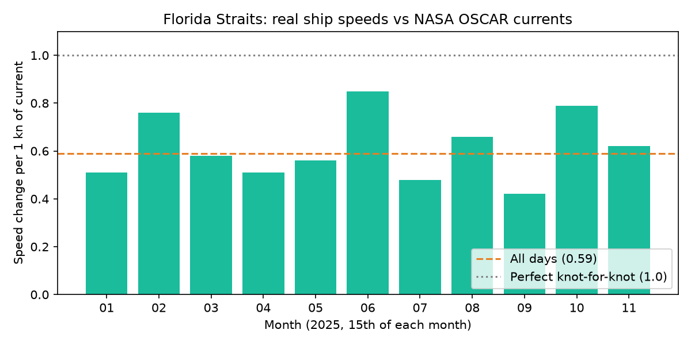

# BATIMETRIX &mdash; Thalassa Maritime Intelligence Platform

**Proactive Hydrodynamic Drag Prediction Engine for Maritime Fuel Optimization**

&#127760; **Live Demo: [batimetrix.onrender.com](https://batimetrix.onrender.com)**
&#128230; **GitHub: [github.com/Batimetrix/batimetrix](https://github.com/Batimetrix/batimetrix)**

Batimetrix estimates hydrodynamic drag along a vessel's route with a physics-informed neural
network (PINN). The network is trained on physics-based synthetic data and uses live NASA inputs
at every route waypoint, refreshed automatically each week: sea surface height (NASA-SSH) and
surface currents (NASA OSCAR). Since November 2026 the current along the ship's track is a model
input (PINN v3).

**Research target: 8-12% net fuel savings and measurable IMO CII rating improvements.**
This target has not been measured yet. Published studies of current-aware ship routing report
fuel savings of about 0.4-3%, and up to about 11% only with error-free current data (see
References).

Built from scratch by an 18-year-old independent researcher from T&uuml;rkiye.

### Key results so far (real data)

- **Ship speeds, Florida Straits (AIS, 11 days in 2025):** satellite currents explain real speed
  changes on every day; accounting for them reduces within-vessel speed variability by 15.9%
  (cross-validated).
- **Replication, Cape Hatteras (AIS, same 11 days):** positive effect on all 11 days; 23.4%
  variability reduction.
- **Fuel, three vessels (FuelCast):** accounting for the along-track current reduced the fuel
  prediction error on all three (by 3-27%; largest where currents were strongest).

Details and limits: see [Early Validation](#early-validation-real-ship-data).

---

## Positioning & Related Work

Vessel performance prediction and voyage optimization are established fields. Companies such as
**Bearing AI**, **ZeroNorth** and **StormGeo** already predict fuel consumption and optimize
voyages using weather, oceanographic and vessel data, and some report high accuracy against real
fleet data.

Batimetrix does not claim to replace these systems. It explores a narrower research question:

> **Can satellite ocean observations &mdash; in particular sea surface height (NASA SWOT,
> NASA-SSH) and satellite-derived surface currents (NASA OSCAR) &mdash; combined with a
> physics-informed neural network, improve hydrodynamic drag prediction along a vessel's route?**

What Batimetrix currently offers:

| Component | Status |
|---|---|
| Physics-informed neural network | Implemented; trained on physics-based synthetic data (v3 adds surface current) |
| Live SSH inputs at route waypoints | Implemented (NASA-SSH simple grid, weekly, 0.5&deg;; 181/188 waypoints) |
| Surface currents | Implemented: NASA OSCAR total surface current (daily, 0.25&deg;), model input via PINN v3 and shown in telemetry |
| Validation of satellite currents against real ship speeds (AIS) | Done: Florida Straits and Cape Hatteras, 11 days each in 2025 |
| Validation against real vessel fuel data | First tests on three vessels from a public dataset (FuelCast, research-only licence); pilot shipowner still needed |
| IMO CII / EU ETS / FuelEU calculators | Implemented (based on estimated savings) |
| 60 trade routes, 15 vessel classes, fleet dashboard | Implemented |
| Data source monitoring (10 sources) | Implemented (availability status only) |
| Open source | Yes |

---

## Early Validation: Real Ship Data

### 1. Satellite currents vs. real ship speeds: Florida Straits

**Question:** Do satellite-derived surface currents (NASA OSCAR) explain real changes in vessel
speed?

**Data:** NOAA MarineCadastre AIS (U.S. waters, 2025, 1-minute positions) in the Florida Straits
(23.5-27.5 N, 81.5-79 W), where the Gulf Stream flows north at up to about 2 m/s, and OSCAR v2.0
daily surface currents (0.25 deg).

**Method:** Large cargo ships and tankers (100 m or longer, AIS types 70-89) under way at 8-25 kn,
excluding positions within 15 km of major ports. For each position, the current component along
the ship's course was computed. Within each vessel, deviations in speed over ground were regressed
on deviations in along-track current, so every ship is compared only with itself. One day per
month, January-November 2025.

**Results:**
- On all 11 days the effect has the expected sign: 0.42-0.85 kn of speed change per 1 kn of
  current (all days: 0.59, r = 0.41, 330,966 positions, 78-125 vessels per day).
- Northbound ships (with the Gulf Stream) were 1.2-3.4 kn faster than southbound ships on every
  day; the gap was among the smallest on the day with the weakest current (Oct 15).

Full table: `validation/results_2025.csv`. Code: `validation/validate_currents.py`.

**Interpretation and limits:** A slope below 1 is expected because OSCAR smooths currents
(0.25 deg, daily, top 30 m) and ships adjust engine settings. Consecutive AIS positions are
correlated, so statistical precision is overstated; the consistency across 11 days is the main
evidence. The Gulf Stream is exceptionally strong, so effects in the Black Sea and Baltic will be
smaller.

### 2. Speed through water (speed over ground minus satellite current)

- **North-south gap:** northbound ships were on average 2.5 kn faster over ground; after
  subtracting the OSCAR along-track current the gap is 0.7 kn (mean absolute, 11 days). About 73%
  of the gap is explained by the satellite current.
- **Full subtraction over-corrects:** on 9 of 11 days southbound ships then appear faster. This
  matches the slope below 1. One possible cause (not yet tested): 0.25 deg OSCAR cells blur the
  sharp western edge of the Gulf Stream, which southbound ships tend to avoid.
- **Within-vessel speed variance:** subtracting the full current reduces it by 8.3% on average
  (range -9.4 to 37.0%). Subtracting a scaled current, with the scale learned on the other 10 days
  (leave-one-day-out), reduces it by 15.9% (range 8.9 to 33.8%).
- **Implication:** currents should enter the drag model as a learned input, not as a direct
  subtraction.

Table: `validation/stw_2025.csv`.

### 3. Replication: Cape Hatteras (North Carolina)

The same analysis was repeated in a second, independent region where the Gulf Stream leaves the
U.S. coast (33.5-36.5 N, 77-74 W), same 11 days.

- Slope positive on all 11 days: 0.4 to 1.47 kn per kn of current (mean of days 0.82).
- Cross-validated within-vessel speed variance reduction: 23.4% on average; clearly positive on
  9 of 11 days, near zero on the rest.
- Fewer vessels than in the Florida Straits (23-40 per day), so day-to-day results are noisier.
  The Gulf Stream meanders strongly here; on days with a small north-south speed gap ships were
  probably outside its core.

Table: `validation/hatteras_2025.csv`.

### 4. Fuel tests: FuelCast dataset

**Data:** CPS Poseidon from the public FuelCast dataset (Krohne Digital; Hugging Face
`krohnedigital/FuelCast`; licence CC BY-NC-ND 4.0, used here for non-commercial research only and
not redistributed). 12 months of 5-minute onboard data: flowmeter fuel consumption, GPS speed over
ground (SOG), speed log speed through water (STW), heading, and model ocean currents from
Open-Meteo. 60,318 under-way records. Vessel position is not included.

**Test 1, current check:** the current measured by the ship (SOG - STW) correlates with the
Open-Meteo along-track current: r = 0.60, slope 0.62 (assuming current in m/s).

**Test 2, fuel prediction:** fuel rate modelled from speed and wave height (cubic in speed),
cross-validated over 5 consecutive time blocks:

| Speed used | Fuel error (RMSE, % of mean) |
|---|---|
| SOG only | 11.57% |
| SOG - 0.7 x along-track current (fixed k, as in the platform) | 9.18% |
| SOG - 1.0 x along-track current (fixed k, physics) | 8.91% |
| SOG - k x current, k fitted per block (0.90-0.95) | 8.93% |
| Measured STW (speed log) | 9.24% |

Accounting for the current reduced the fuel prediction error by about 21-23% without fitting k.
Current-corrected SOG did slightly better than the speed log, which reads on average 0.23 m/s
above SOG; this probably reflects speed log bias rather than better-than-perfect information.

**Replication on two more vessels** (same fuel model, fixed k, speed log not needed; under-way
records with SOG above 3 m/s; code `fuelcast_three_ships.py`):

| Vessel | Type | Records | Median along-track current (m/s) | Fuel error, k = 0 | k = 0.7 | k = 1.0 |
|---|---|---|---|---|---|---|
| CPS Poseidon | Cruise ship | 60,415 | 0.15 | 11.57% | 9.18% (-20.7%) | 8.91% (-23.0%) |
| CPS Triton | Cruise ship | 18,271 | 0.07 | 12.26% | 11.92% (-2.8%) | 11.81% (-3.7%) |
| OSS Ceto | Offshore vessel | 6,453 | 0.21 | 43.28% | 35.83% (-17.2%) | 31.68% (-26.8%) |

The error fell on all three vessels. The gain was smallest on Triton, which sailed in the weakest
currents. Ceto's fuel use is poorly explained by speed alone (43% error), possibly because offshore
vessels often operate at low speed or hold position; its along-track current uses course over
ground because no heading was available.

**Limits:** three vessels from one dataset; total fuel includes hotel load; currents from Open-Meteo, not NASA
OSCAR; position unknown; current units assumed. Open question: propulsion shaft power did not show
the same improvement (errors about 38% for all speed inputs, dominated by other factors).
Code: `fuelcast_test.py`, `fuelcast_robust.py`.

**What these tests show and do not show:** they show that knowing the current makes ship speed and
fuel use more predictable. They do not yet measure fuel savings from using Batimetrix.

---

## Data Sources

**Live inputs used in the platform today:**

| Dataset | Measurement | Update | Role in Batimetrix |
|---|---|---|---|
| NASA-SSH Simple Gridded SSH (V1.1) | Sea surface height anomaly, 0.5&deg; | Weekly | SSH input at 181/188 waypoints and 15/16 Ocean Intel zones |
| OSCAR v2.0 NRT (ESR / NASA) | Total surface current, 0.25&deg; | Daily (refreshed weekly) | Along-track current input to PINN v3 at 190 route points; shown in telemetry |

**Monitored sources (availability status only, not model inputs):**

| Source | Measurement | Intended role |
|---|---|---|
| SWOT (NASA/CNES) | Sea surface height (ssh_karin) | Higher-resolution SSH near straits |
| Sentinel-6 (NASA/ESA) | Sea surface height, wave height | SSH continuity; measured wave height |
| GPM IMERG (NASA/JAXA) | Precipitation | Storm conditions |
| MODIS (NASA) | Sea surface temperature | Kinematic viscosity correction |
| CYGNSS (NASA) | Ocean surface wind speed | Wave loading |
| PACE OCI (NASA) | Ocean color | Exploratory |
| SMAP (NASA) | Sea surface salinity | Water density correction |
| ICESat-2 (NASA) | Sea ice and ocean height | Arctic routes |
| NISAR (NASA/ISRO) | L-band SAR | Vessel wake detection (planned) |
| GEBCO (IHO-IOC, not NASA) | Bathymetry | Shallow-water resistance |

SWOT data (296,526 measurements over the Black Sea) was used in an early training step; see Model
Architecture for its limits.

---

## Model Architecture

**Physics-informed neural network (PINN), v2: 1,657,025 parameters**

- Input: 7 features (lat, lon, depth, SSH anomaly, wave height, speed, draft)
- 6 residual blocks, 512 neurons each, GELU activation, LayerNorm
- Output: normalized drag score in [0, 1]

**Physics in the training targets** (synthetic data generated from formulas):
- ITTC 1957 friction line: `Cf = 0.075 / (log10(Re) - 2)^2`, with Reynolds number from speed and
  draft
- Empirical wave factor: `1 + 0.2 (Hs / 3)^1.8`
- Shallow-water factor: `1 + 0.5 exp(-depth / 30)`

**Physics in the loss function:**
- v2: lower bounds on the predicted drag that grow with wave height and in shallow water
- v3: lower bound for wave height, and a monotonic constraint: more following current must not
  increase drag per nm

**Training (v2):** 100,000 synthetic samples (up to 100 epochs, AdamW, CosineAnnealingLR). A second
step used 10,000 points sampled from 296,526 SWOT measurements over the Black Sea, but its targets
were computed from the same formula with fixed speed, draft and depth, so it adds little
real-world information. All training targets are synthetic; the model has not yet been trained on
measured vessel data.

**PINN v3: current-aware (November 2026), 1,657,537 parameters:** `training_v3.py`,
`batimetrix_v3_current.pt`
- Adds an 8th input: surface current along the ship's track (kn).
- Target: drag per nautical mile over ground, `drag x STW / SOG`, with `SOG = STW + k x current`.
- `k = 0.7` was measured from real AIS data against NASA OSCAR currents (Florida Straits 0.59,
  Cape Hatteras 0.82). It is a calibration for OSCAR currents, not a physical constant, and may
  partly reflect ships adjusting engine power.
- An unphysical latitude factor used in v2 was removed from the training targets.
- In the platform, v3 provides a current adjustment factor (drag with current / drag with zero
  current) that multiplies the v2 drag score, so existing thresholds remain valid.
- Check against the formula: the model gets the direction right at all tested currents but
  overestimates the effect of following currents (about -15% instead of -10% at +2 kn).

**Deployment:** the live platform runs the PyTorch models directly. An ONNX export (12.2 KB graph +
6.6 MB external weights, max deviation vs PyTorch 2.98e-08) exists but is not used in production.

---

## Platform Features

- **60 global trade routes** &mdash; Black Sea, Mediterranean, Suez, Cape, Arctic NSR,
  Trans-Pacific, Trans-Atlantic
- **15 vessel classes** &mdash; VLCC, Suezmax, Aframax, MR, LNG, Capesize, Panamax, ULCV, Feeder and
  more
- **Fleet Dashboard** &mdash; multi-vessel portfolio analysis
- **Ocean Intel** &mdash; 16 global maritime zones with live SSH anomaly values (NASA-SSH, weekly;
  15/16 zones)
- **3D Globe** &mdash; interactive visualization of live SSH anomaly values (weekly)
- **IMO CII** &mdash; rating calculation based on MEPC.354(78)
- **7 languages** &mdash; EN, TR, EL, ZH, RU, ES, FR
- **PDF report** &mdash; downloadable analysis report
- **Intelligence-style sidebar** &mdash; navigation across all modules
- **EU ETS Carbon Calculator** &mdash; 2026 scope (100% of emissions)
- **FuelEU Maritime Calculator** &mdash; GHG intensity compliance
- **Speed Optimization Wizard** &mdash; SSH-adjusted optimal speed
- **Execution Gap Analyzer** &mdash; planned vs actual voyage analysis
- **Route Comparison** &mdash; dual route efficiency analysis
- **NISAR SAR Integration** &mdash; *planned*: vessel wake detection (NASA/ISRO)

---

## Current Estimates & Assumptions

- Model drag scores depend on vessel type, speed, draft, sea state and, since v3, along-track
  current. Status labels are relative, not absolute: EFFICIENT / NOMINAL / HIGH DRAG thresholds
  (0.52 / 0.65) are set at the 33rd and 66th percentiles of model outputs across all 60 routes
  under typical speeds, drafts and sea states.
- Fuel savings shown in the platform are **estimates**, derived from the drag score through an
  assumed linear conversion factor and capped at 15% (no minimum, so high-drag routes show lower
  savings). They are not measured results.
- CII rating changes (e.g. E to D, B to A) are computed from these estimated savings.
- Baseline daily fuel consumption per vessel class is based on Lloyd's List / MAN Energy Solutions
  reference values.

---

## Limitations & Roadmap

Batimetrix is an early-stage research platform. Known limitations:

- **Limited fuel validation.** Tests on three vessels (FuelCast) show that
  current-corrected speed improves fuel prediction, but the drag model itself has not been
  validated against measured vessel drag or fuel consumption. Next step: noon-report data (daily
  position, speed, fuel) from a pilot shipowner.
- **Coarse SSH resolution.** NASA-SSH (weekly, 0.5&deg;) cannot resolve narrow straits or coastal
  areas; 7 of 188 waypoints fall back to reference values. Next step: higher-resolution SWOT data
  near straits.
- **Currents in narrow straits.** OSCAR (0.25&deg;) cannot resolve narrow straits: at the Istanbul
  Strait it shows a weak northward current, while the real surface flow is southward.
- **SSH sensitivity and training assumptions.** The model takes SSH anomaly as input, normalized as
  (ssha + 2) / 4. Real anomalies are typically within +/-0.1 m, so this input has only a small
  effect. In the SWOT training step, wave height was estimated from SSH with an assumed relation
  (1.5 + 0.3 |ssha|) rather than measured. Next step: retrain with measured significant wave
  height and real-data targets.
- **NISAR.** SAR-based vessel wake detection and surface roughness estimation are planned, using
  calibrated NISAR L-band products publicly available through the ASF DAAC.

Feedback and collaboration are welcome.

---

## Stack

| Layer | Technology |
|---|---|
| ML Model | PyTorch PINN (v2 + current-aware v3); ONNX export available, not used in production |
| Backend | Python / Flask |
| Frontend | HTML/CSS/JS, Leaflet.js |
| Data access | NASA Earthdata / earthaccess (PO.DAAC); CMR API for source status |
| Automation | GitHub Actions &mdash; weekly NASA data refresh and redeploy |
| Deployment | Render.com |

---

## Contact

**Mehmet Sinan Bilge&ccedil;**
mbilgec@asu.edu
Independent Researcher | ASU Online student, T&uuml;rkiye

---

*Batimetrix is the foundation of Thalassa &mdash; a maritime intelligence platform vision combining
NASA satellite data, physics-informed AI and ocean analytics.*

---

## Data Credits

- Sea surface height: NASA-SSH Simple Gridded SSH (NASA PO.DAAC), CC BY 4.0.
- Surface currents: OSCAR v2.0 Near Real Time, Earth & Space Research / NASA PO.DAAC,
  doi:10.5067/OSCAR-25N20.
- SWOT data: NASA / CNES via NASA PO.DAAC.
- AIS (validation): Office for Coastal Management, Nationwide Automatic Identification System
  2025, https://www.fisheries.noaa.gov/inport/item/77594 (accessed November 2026).
- Fuel test: FuelCast dataset, Krohne Digital, Hugging Face `krohnedigital/FuelCast`,
  CC BY-NC-ND 4.0 (research use only; data not redistributed). Ocean currents in that dataset are
  from Open-Meteo.

## References

- Yang, Chen, Zhao, Rytter (2020). Ship Speed Optimization Considering Ocean Currents to Enhance
  Environmental Sustainability in Maritime Shipping. *Sustainability* 12(9), 3649.
- Ship Routing Through Altimetry-Derived Ocean Currents (1999). *Transportation Science* 33(1),
  49-67.
- ESA (2015). ESA helps faster, cleaner shipping (Globcurrent project).
